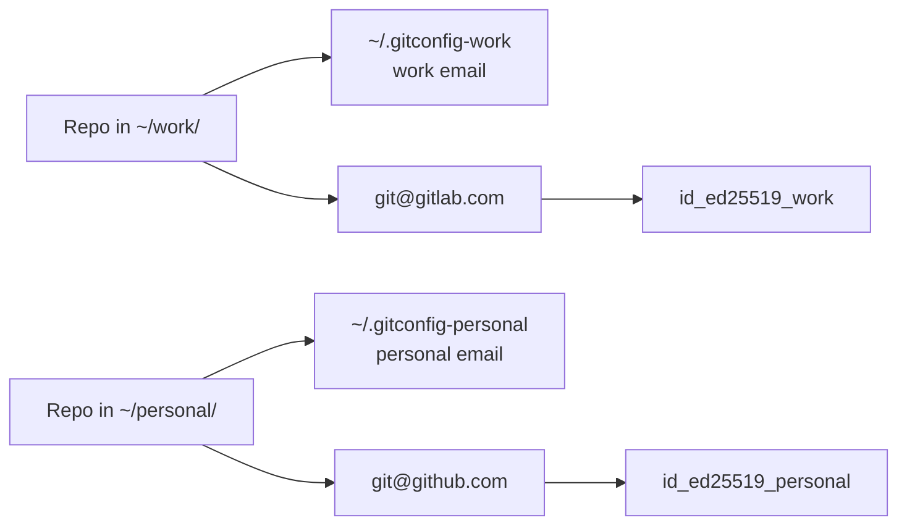

You get a new laptop, clone a work repo, push a fix — and later notice the commit went out under your personal Gmail. Or worse: `git push` to GitHub fails with `Permission denied (publickey)` because SSH offered your work key first.

If you use **GitLab for work** and **GitHub for personal** projects, there's a clean way to make this a non-issue. Because the two accounts live on different hosts, SSH can pick the right key by **host**, and Git can pick the right name and email by **folder**. Set it up once and you never think about it again.



> Commands below are for macOS, Linux, or Git Bash on Windows. Windows-specific differences are called out where they matter.

Throughout the post, replace these placeholders with your own values:

- `Your Name` — your name as it should appear on commits
- `you@work-email.com` — the email on your GitLab account
- `you@personal-email.com` — the email on your GitHub account
- `gitlab.com` — your company's GitLab host, if it's self-hosted (e.g. `gitlab.company.com`)

## Part one: two SSH keys, one per host

### Check the tools and create the folders

```bash
git --version
ssh -V
mkdir -p ~/work ~/personal
```

This is the whole convention: every work repo lives under `~/work`, every personal repo under `~/personal`.

### Generate one key per account

```bash
ssh-keygen -t ed25519 -C "you@work-email.com" -f ~/.ssh/id_ed25519_work
ssh-keygen -t ed25519 -C "you@personal-email.com" -f ~/.ssh/id_ed25519_personal
```

Set a passphrase when prompted. The agent will remember it so you're not typing it on every push.

### Load the keys into the ssh-agent

On **macOS**, store the passphrases in the Keychain:

```bash
eval "$(ssh-agent -s)"
ssh-add --apple-use-keychain ~/.ssh/id_ed25519_work
ssh-add --apple-use-keychain ~/.ssh/id_ed25519_personal
```

On **Linux / Git Bash**:

```bash
eval "$(ssh-agent -s)"
ssh-add ~/.ssh/id_ed25519_work
ssh-add ~/.ssh/id_ed25519_personal
```

> **Windows with the built-in OpenSSH:** the agent service is disabled by default. Enable it once from an admin PowerShell: `Get-Service ssh-agent | Set-Service -StartupType Automatic; Start-Service ssh-agent`

### Tell SSH which key belongs to which host

```bash
nano ~/.ssh/config
```

```bash
# Personal - GitHub
Host github.com
  HostName github.com
  User git
  IdentityFile ~/.ssh/id_ed25519_personal
  IdentitiesOnly yes

# Work - GitLab
Host gitlab.com
  HostName gitlab.com
  User git
  IdentityFile ~/.ssh/id_ed25519_work
  IdentitiesOnly yes
```

`IdentitiesOnly yes` is the line that matters most. Without it, the agent happily offers *every* key it holds, and the server accepts whichever matches first — which is how you end up authenticated as the wrong user.

> **Self-hosted GitLab?** Replace `gitlab.com` on both the `Host` and `HostName` lines with your company host. If SSH runs on a non-standard port, add `Port 2222` (or whatever it is) to that block.

On macOS, add these two lines inside each block so the keys reload after a reboot:

```bash
  AddKeysToAgent yes
  UseKeychain yes
```

Then lock down the file:

```bash
chmod 600 ~/.ssh/config
```

### Add the public keys to each account

```bash
cat ~/.ssh/id_ed25519_personal.pub   # paste into GitHub
cat ~/.ssh/id_ed25519_work.pub       # paste into GitLab
```

- **GitHub:** Settings → SSH and GPG keys → New SSH key
- **GitLab:** Avatar → Edit profile / Preferences → SSH Keys → Add new key

### Test both connections

```bash
ssh -T git@github.com
# Hi <github-username>! You've successfully authenticated...

ssh -T git@gitlab.com
# Welcome to GitLab, @<gitlab-username>!
```

Type `yes` the first time to trust each host. If either greets the wrong username, the wrong key is being offered — go back to the SSH config.

## Part two: two Git identities, picked by folder

SSH now knows *how* to authenticate. Git still needs to know *who you are* on each commit.

### One identity file per account

```bash
cat > ~/.gitconfig-work <<'EOF'
[user]
    name = Your Name
    email = you@work-email.com
EOF

cat > ~/.gitconfig-personal <<'EOF'
[user]
    name = Your Name
    email = you@personal-email.com
EOF
```

### Let the main config choose by folder

```bash
nano ~/.gitconfig
```

```bash
[user]
    useConfigOnly = true

[includeIf "gitdir:~/work/"]
    path = ~/.gitconfig-work

[includeIf "gitdir:~/personal/"]
    path = ~/.gitconfig-personal

[init]
    defaultBranch = main
```

Two details that are easy to get wrong:

- **Keep the trailing `/`** on the `gitdir:` paths. With it, the rule matches every repo *inside* that folder.
- **`useConfigOnly = true`** makes Git refuse to commit when no identity matched. That's the safety net: a repo cloned outside the two folders can't silently commit under a guessed email.

> **Windows:** write the paths like `"gitdir/i:C:/Users/<you>/work/"`. The `/i` makes the match case-insensitive, which you want on Windows paths.

## Part three: clone and verify

```bash
cd ~/work
git clone git@gitlab.com:your-group/your-repo.git
cd your-repo
git config user.email      # → you@work-email.com

cd ~/personal
git clone git@github.com:your-user/your-repo.git
cd your-repo
git config user.email      # → you@personal-email.com
```

> Run `git config user.email` from **inside a repo**. `includeIf gitdir:` only kicks in within a Git repository, so in the bare `~/work` folder it prints nothing — that's expected, not broken.

## When something goes wrong

- **`Permission denied (publickey)`** — the public key isn't on the account, or `IdentityFile` points to the wrong path.
- **Authenticated as the wrong user** — `IdentitiesOnly yes` is missing from that host block.
- **Commits show the wrong email** — the repo lives outside `~/work` / `~/personal`, or the `gitdir:` path lost its trailing `/`.
- **`fatal: no email was given and auto-detection is disabled`** — that's `useConfigOnly` doing its job. Move the repo into the right folder, or set an identity just for that repo with `git config user.email "..."`.
- **An old repo was cloned over HTTPS** — switch it to SSH: `git remote set-url origin git@github.com:your-user/your-repo.git`
- **Not sure which key is being offered** — `ssh -vT git@github.com 2>&1 | grep Offering`

## The recap checklist

- Two folders: `~/work` and `~/personal`
- Two keys: `id_ed25519_work` and `id_ed25519_personal`, both loaded into the agent
- `~/.ssh/config` maps `gitlab.com` → work key and `github.com` → personal key, with `IdentitiesOnly yes`
- Public keys added to GitLab and GitHub, and `ssh -T` greets the right user on each
- `~/.gitconfig-work` and `~/.gitconfig-personal` hold each identity
- `~/.gitconfig` uses `includeIf "gitdir:..."` plus `useConfigOnly = true`
- Verified with `git config user.email` inside a cloned repo from each folder

The nice part is that after this, there's no habit to keep up. You don't switch profiles or remember flags — where you clone a repo decides which key and which email it uses. If you hit an edge case this doesn't cover, reach out — I'm happy to help.
